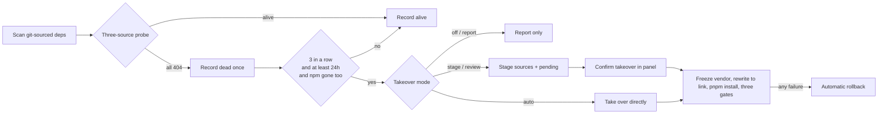

<div align="center">

# dsh-plugin-guard

**Watch the upstream repositories of your DSH plugins - if a repo disappears, the plugin keeps running.**

<p><strong>English</strong> · <a href="README.zh-CN.md">简体中文</a></p>

[](CHANGELOG.md)
[](#scope)
[](#prerequisites)
[](docs/compatibility.md)
[](LICENSE)

[Quick start](#install) · [Scope](#scope) · [Takeover modes](#takeover-modes) · [Parameters](#parameters) · [Known limitations](#known-limitations)

</div>

```powershell
dsh plugin --profile web add github:suhong11300/dsh-plugin-guard
```

Then open **Settings → Upstream guard**.

---

## Why you need it

DSH plugins are usually installed straight from `github:owner/repo`. Personal repositories get deleted, made private, or renamed - after that `pnpm install` can never fetch them again, and the plugin becomes impossible to reinstall.

| Without it | With it |
| --- | --- |
| Upstream returns 404; the only option is `robocopy` + hand-editing dependencies + manual verification | After 3 consecutive dead confirmations it takes over according to the configured mode, verifies through three acceptance gates, and rolls back automatically on failure |
| No idea which plugins are at risk | Every sweep leaves an auditable liveness report and a source snapshot |
| Manual takeover has no notion of versions | `vendor/<pkg>/<version>-<digest>` is versioned, and old copies are never deleted |

## Scope

| | |
| --- | --- |
| ✅ **Good fit** | You installed several `github:`-sourced plugins, most of them personal projects that may be deleted, made private, or renamed - and you want the plugin to keep running rather than look for a replacement |
| ✅ **Also useful** | Self-hosted plugin marketplaces, machines shared by several people, any setup that needs an auditable liveness record plus source snapshots |
| ⚠️ **Not needed** | npm-only installs (the registry is a fallback); macOS / Linux (the scripts and scheduled tasks target Windows); setups where nothing may rewrite dependencies (installable, but stay on `off` / `report` and it degrades to a pure prober) |
| 📦 **Prerequisite** | At least one `github:`-sourced dependency in the target profile, otherwise there is nothing to scan |

It does **not**: judge plugin quality, update plugins, touch npm packages, or modify upstream repositories. It answers one question only - if upstream is gone, can this machine still install the plugin back?

## How it works



1. **Probe**: `github.com/<o>/<r>`, `codeload.github.com/<o>/<r>/tar.gz/refs/heads/{main,master}` and `registry.npmjs.org/<pkg>` are cross-checked, which sidesteps the 60-requests-per-hour quota of the unauthenticated GitHub API (30 repositories would already return 403).
2. **Decide**: both repository sources return 404 and npm does not know the package either → one dead is recorded; 3 consecutive dead probes plus at least 24 hours since the first one → confirmed dead.
3. **Take over**: `~/.dsh/vendor/<pkg>/<version>-<digest>` → dependency rewritten to `link:` → `pnpm install` → gates (realpath lands in vendor / name and version match / `--dump-config` passes) → any failure rolls back.
4. **Snapshot**: isolated by package / profile / version / content hash, with a per-file sha256 check.

## Takeover modes

| Mode | Writes vendor | Rewrites profile deps | Who triggers |
| :--- | :---: | :---: | --- |
| `off` | - | - | Pure prober: only updates state and reports |
| `report` | - | - | Additionally emits a `review-required` record |
| `stage` | staging only | - | Automatic |
| **`review`** (default) | ✅ | ✅ | Only when you click Confirm takeover in the panel |
| `auto` | ✅ | ✅ | Automatic, bounded by budgets and the failure breaker |

## Install

### Prerequisites

- Windows 10 / 11
- **PowerShell 7** (`pwsh.exe`; `run-guard.cmd` looks it up automatically across Program Files → WindowsApps → the profile `@dsh-ops\pwsh-win32-x64`)
- Node ≥ 20, with a working `dsh` CLI
- DSH `0.2.0-rc.2`, and at least one `github:`-sourced plugin already present in the target profile

### 1 · Install into a profile (pick one)

**A. git source (recommended)** - `lib/` is committed build output and there is no `prepare` hook, so it works right after installation:

```powershell
dsh plugin --profile web add github:suhong11300/dsh-plugin-guard
```

**B. Fixed directory + `link:`** - when scheduled tasks need a stable entry point that does not move with the pnpm directory, or for offline deployment:

```powershell
git clone https://github.com/suhong11300/dsh-plugin-guard "$env:USERPROFILE\.dsh\vendor\dsh-plugin-guard"
```

Then write in the profile `package.json`:

```json
"dsh-plugin-guard": "link:C:/Users/<you>/.dsh/vendor/dsh-plugin-guard"
```

> Under `link:` Node resolves through realpath: if the vendored package needs to require an external dependency (for example `@deepseek-ai/schemastery`), `~/.dsh/vendor/node_modules` must be a junction pointing at some profile `node_modules`.

### 2 · desktop profile (Electron-exclusive, the CLI cannot install it)

```powershell
cd "$env:USERPROFILE\.dsh\profiles\desktop"
pnpm add github:suhong11300/dsh-plugin-guard
```

Then add `"dsh-plugin-guard"` to `dsh.profile.bundles` in that `package.json` and **restart Electron**.

### 3 · Enable panel actions

`profiles/<profile>/cordis.patch.yml` (without it the panel is read-only):

```yaml
- id: plugin-guard
  config:
    allowActions: true
```

### 4 · Scheduled tasks (optional, recommended)

```powershell
schtasks /Create /TN DshPluginGuard-Daily /TR "$env:USERPROFILE\.dsh\profiles\web\node_modules\dsh-plugin-guard\backend\run-guard.cmd daily" /SC DAILY /ST 09:05 /F
schtasks /Create /TN DshPluginGuard-Logon /TR "$env:USERPROFILE\.dsh\profiles\web\node_modules\dsh-plugin-guard\backend\run-guard.cmd login" /SC ONLOGON /DELAY 0003:00 /F
```

Replace `web` in the path with the profile you actually installed; with `link:` use the vendor directory. The mode can be overridden by an environment variable: `DSH_GUARD_TAKEOVER_MODE=auto` (default `review`).

### 5 · Verify the install

```powershell
# Config layer: is the plugin loaded
dsh --profile web --dump-config | Select-String plugin-guard

# Runtime: does the panel API answer (use the port of your own web instance)
curl.exe -s -H "x-plugin-guard: 1" http://127.0.0.1:19390/api/plugin-guard/state

# Script layer: read-only dry run, no state / report / log writes, no snapshot
& "$env:USERPROFILE\.dsh\profiles\web\node_modules\dsh-plugin-guard\backend\guard.ps1" -Profiles all -DryRun
```

All three passing means it is installed. Each panel row shows the last probe time, liveness and takeover result.

## Everyday commands

```powershell
$G = "$env:USERPROFILE\.dsh\profiles\web\node_modules\dsh-plugin-guard\backend"

& "$G/guard.ps1" -Profiles all -DryRun                       # dry run, writes nothing
& "$G/guard.ps1" -Profiles all -NoSnapshot                    # one sweep in the current mode
& "$G/guard.ps1" -Profiles all -TakeoverMode auto -TakeoverMaxTotal 5
& "$G/guard.ps1" -Profiles all -ResetCircuit -NoSnapshot      # reset the failure breaker

& "$G/takeover.ps1" -Package <pkg> -Profile web -Stage         # one package: stage sources
& "$G/takeover.ps1" -Package <pkg> -Profile web -Apply         # one package: take over
& "$G/takeover.ps1" -Package <pkg> -Profile web -Revert        # one package: roll back
```

`-JsonOnly` prints a single JSON blob (all other logs go to stderr) for the host side to parse.

## Parameters

| Option | Default | Purpose |
| --- | :---: | --- |
| `-TakeoverMode` | `review` | Mode, see the table above |
| `-ConfirmRuns` | `3` | How many consecutive dead probes are required |
| `-MinHours` | `24` | Minimum hours since the first dead verdict |
| `-RequireNpmGone` | `true` | Also require that the npm registry cannot resolve the package |
| `-TakeoverAllowProfiles` | `all` | Profile allow-list for takeover (comma separated) |
| `-TakeoverMaxPerRun` | `1` | How many profiles may actually be rewritten per sweep |
| `-TakeoverMaxTotal` | `5` | Rolling 24-hour budget, `0` = unlimited (recorded in `takeoverLedger`, spans sweeps) |
| `-TakeoverFailureBreaker` | `3` | Consecutive failures before the breaker trips and the guard degrades to report-only; `-ResetCircuit` resets it |
| `-KeepVersions` | `3` | Historical vendor copies kept per package (old directories are never deleted) |

<details>
<summary>Why are the thresholds stricter than reporting?</summary>

A false positive in reporting only costs you a second look at the report; a false takeover really rewrites the dependencies of another profile. So the default requires **3 runs + 24 hours + npm gone** to hold at the same time, and `auto` additionally enforces per-run / 24-hour budgets plus the failure breaker.

</details>

<details>
<summary>Paths and files</summary>

| Item | Location |
| --- | --- |
| Data root | `-DshHome` > `DSH_HOME` > `~/.dsh` |
| Report root | `-GuardDir` > `DSH_GUARD_DIR` > `<DshHome>/plugin-guard` (`state.json` / `reports/` / `snapshots/` / `staging/` / `log/`) |
| vendor | `<DshHome>/vendor/<pkg>/<version>-<digest>` |
| Shared lock | `<DshHome>/.plugin-guard.lock` (the file stays on disk; mutual exclusion relies on the OS handle) |

| File | Purpose |
| --- | --- |
| `backend/common.ps1` | Order-preserving probing, atomic JSON, snapshot hash verification |
| `backend/guard.ps1` | State machine, mode dispatch, budgets and breaker, reporting |
| `backend/takeover.ps1` | Per-package transaction: `-Stage` / `-Apply` / `-Revert` plus three gates |
| `backend/scan-upstream.ps1` | Read-only sweep built on the same classifier |
| `backend/run-guard.cmd` | Scheduled-task entry point (locates PowerShell 7) |
| `lib/index.js` · `lib/client.js` | Panel, HTTP routes, process lifecycle |

</details>

## Tests

```powershell
$env:DSH_GUARD_PWSH = 'C:\Program Files\PowerShell\7\pwsh.exe'   # optional: PATH and Program Files are probed by default
npm test
```

All three suites (`safety` / `regression` / `review-regression`) build fake profiles under the system temp directory and never read or write real profiles, state or reports; entry point `tests/run-all.mjs`.

## Known limitations

- **`--dump-config` is not runtime behaviour**: it only proves the configuration composes, not that the plugin behaves correctly.
- **A snapshot is not a dependency closure**: it contains no `node_modules`, so you cannot reinstall offline from it.
- **Module resolution under `link:`**: Node follows realpath, so a vendored package that requires external dependencies relies on the `~/.dsh/vendor/node_modules` junction.
- **desktop cannot use the CLI**: Electron owns that profile - `pnpm add`, hand-write `dsh.profile.bundles`, then restart.
- **Panel buttons are same-origin only**: the `x-plugin-guard: 1` header, a loopback origin and `allowActions: true` are all required.

## License

[MIT](LICENSE) © 2026 suhong11300
