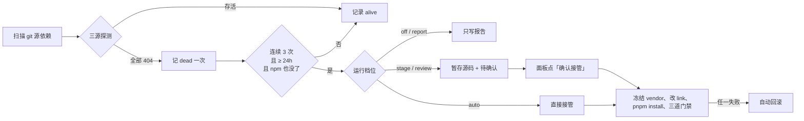

<div align="center">

# dsh-plugin-guard

**盯住 DSH 插件的上游仓库；它被删了，插件照常跑。**

<p><strong>简体中文</strong> · <a href="README.en.md">English</a></p>

[](CHANGELOG.md)
[](#适用范围)
[](#前置条件)
[](docs/compatibility.md)
[](LICENSE)

[快速开始](#安装) · [适用范围](#适用范围) · [运行档位](#运行档位) · [参数](#参数) · [已知限制](#已知限制)

</div>

```powershell
dsh plugin --profile web add github:suhong11300/dsh-plugin-guard
```

装完打开 **设置 → 上游守护**。

---

## 为什么需要它

DSH 插件常用 `github:owner/repo` 直接装。个人仓库会删、会转私有、会改名——那之后 `pnpm install` 就再也拉不回来了，插件当场变成不可重装状态。

| 没有它 | 有它 |
| --- | --- |
| 上游 404，只能自己 `robocopy` + 手改依赖 + 手动验证 | 连续 3 次确认死亡后按档位自动/半自动接管，三步门禁验收，失败自动回滚 |
| 不知道哪些插件有风险 | 每次巡检留一份存活报告与源码快照，可审计 |
| 手工接管没有版本概念 | `vendor/<pkg>/<version>-<digest>` 版本化，旧副本永不删除 |

## 适用范围

| | |
| --- | --- |
| ✅ **该用** | 装了若干 `github:` 源插件，且仓库多为个人项目——可能删库、转私有、改名；你希望上游消失后插件照常跑，而不是重新找替代品 |
| ✅ **也用得上** | 自建插件集市、多人共用一台机器、需要可审计的上游存活记录与源码快照 |
| ⚠️ **不必用** | 只用 npm 官方包（registry 有兜底）；macOS / Linux（脚本与计划任务按 Windows 写）；不允许任何自动改写（可装，但请用 `off` / `report` 档，退化为纯巡检器） |
| 📦 **前提** | 目标 profile 里至少有一个 `github:` 源依赖，否则扫不到东西 |

它**不做**：不判断插件好坏、不更新插件、不碰 npm 包、不改上游仓库。只解决「上游没了，本机还能不能装回来」。

## 工作方式



1. **探测**：`github.com/<o>/<r>`、`codeload.github.com/<o>/<r>/tar.gz/refs/heads/{main,master}`、`registry.npmjs.org/<pkg>` 三源交叉。绕开未认证 GitHub API 的 60 次/小时配额（30 个仓库就会 403）。
2. **判定**：前两源都 404 且 npm 也查不到 → 记 dead；连续 3 次 + 距首次 ≥ 24h → 确认死亡。
3. **接管**：`~/.dsh/vendor/<pkg>/<version>-<digest>` → 依赖改 `link:` → `pnpm install` → 门禁（realpath 命中 vendor / name+version 匹配 / `--dump-config` 通过）→ 任一失败回滚。
4. **快照**：按 包 / profile / 版本 / 内容哈希 隔离，逐文件 sha256 校验。

## 运行档位

| 档 | 写 vendor | 改 profile 依赖 | 谁触发 |
| :--- | :---: | :---: | --- |
| `off` | — | — | 纯巡检，只更新状态与报告 |
| `report` | — | — | 额外产出 `review-required` 记录 |
| `stage` | 仅 staging | — | 自动 |
| **`review`**（默认） | ✅ | ✅ | 面板点「确认接管」才执行 |
| `auto` | ✅ | ✅ | 自动，受预算与熔断约束 |

## 安装

### 前置条件

- Windows 10 / 11
- **PowerShell 7**（`pwsh.exe`；`run-guard.cmd` 会按 Program Files → WindowsApps → profile 内 `@dsh-ops\pwsh-win32-x64` 自动查找）
- Node ≥ 20，`dsh` CLI 可用
- DSH `0.2.0-rc.2`，目标 profile 里已有至少一个 `github:` 源插件

### 1 · 装到 profile（二选一）

**A. git 源（推荐）** —— `lib/` 是已提交的构建产物，无 `prepare` 钩子，装完即用：

```powershell
dsh plugin --profile web add github:suhong11300/dsh-plugin-guard
```

**B. 固定目录 + `link:`** —— 计划任务需要不随 pnpm 目录变化的稳定入口，或要离线部署：

```powershell
git clone https://github.com/suhong11300/dsh-plugin-guard "$env:USERPROFILE\.dsh\vendor\dsh-plugin-guard"
```

再在 profile 的 `package.json` 写：

```json
"dsh-plugin-guard": "link:C:/Users/<you>/.dsh/vendor/dsh-plugin-guard"
```

> `link:` 下 Node 按 realpath 解析：vendor 里的包若要 require 外部依赖（如 `@deepseek-ai/schemastery`），需要 `~/.dsh/vendor/node_modules` 是指向某 profile `node_modules` 的 junction。

### 2 · desktop profile（Electron 独占，CLI 装不了）

```powershell
cd "$env:USERPROFILE\.dsh\profiles\desktop"
pnpm add github:suhong11300/dsh-plugin-guard
```

再把 `"dsh-plugin-guard"` 加进该 `package.json` 的 `dsh.profile.bundles`，**重启 Electron** 生效。

### 3 · 打开面板操作

`profiles/<profile>/cordis.patch.yml`（不写则面板只读）：

```yaml
- id: plugin-guard
  config:
    allowActions: true
```

### 4 · 计划任务（可选，推荐）

```powershell
schtasks /Create /TN DshPluginGuard-Daily /TR "$env:USERPROFILE\.dsh\profiles\web\node_modules\dsh-plugin-guard\backend\run-guard.cmd daily" /SC DAILY /ST 09:05 /F
schtasks /Create /TN DshPluginGuard-Logon /TR "$env:USERPROFILE\.dsh\profiles\web\node_modules\dsh-plugin-guard\backend\run-guard.cmd login" /SC ONLOGON /DELAY 0003:00 /F
```

路径里的 `web` 换成你实际装的 profile；用 `link:` 方式时换成 vendor 目录。档位可用环境变量覆盖：`DSH_GUARD_TAKEOVER_MODE=auto`（默认 `review`）。

### 5 · 装完自检

```powershell
# 配置层：图层是否加载
dsh --profile web --dump-config | Select-String plugin-guard

# 运行时：面板 API 是否应答（端口换成本机 web 实例的）
curl.exe -s -H "x-plugin-guard: 1" http://127.0.0.1:19390/api/plugin-guard/state

# 脚本层：只读预演，不动 state / report / log，不建快照
& "$env:USERPROFILE\.dsh\profiles\web\node_modules\dsh-plugin-guard\backend\guard.ps1" -Profiles all -DryRun
```

三条都通即装好。面板每行显示最近探测时间、存活状态与接管结果。

## 快速使用

```powershell
$G = "$env:USERPROFILE\.dsh\profiles\web\node_modules\dsh-plugin-guard\backend"

& "$G/guard.ps1" -Profiles all -DryRun                       # 预演，什么都不写
& "$G/guard.ps1" -Profiles all -NoSnapshot                    # 按当前档位跑一轮
& "$G/guard.ps1" -Profiles all -TakeoverMode auto -TakeoverMaxTotal 5
& "$G/guard.ps1" -Profiles all -ResetCircuit -NoSnapshot      # 熔断复位

& "$G/takeover.ps1" -Package <pkg> -Profile web -Stage         # 单包：暂存源码
& "$G/takeover.ps1" -Package <pkg> -Profile web -Apply         # 单包：接管
& "$G/takeover.ps1" -Package <pkg> -Profile web -Revert        # 单包：回滚
```

`-JsonOnly` 只输出一段 JSON（其余日志走 stderr），供 host 侧解析。

## 参数

| 参数 | 默认 | 作用 |
| --- | :---: | --- |
| `-TakeoverMode` | `review` | 档位，见上表 |
| `-ConfirmRuns` | `3` | 连续几次探测判 dead 才算数 |
| `-MinHours` | `24` | 距首次判 dead 至少过多少小时 |
| `-RequireNpmGone` | `true` | 同时要求 npm registry 也查不到同名包 |
| `-TakeoverAllowProfiles` | `all` | 允许接管的 profile 白名单（逗号分隔） |
| `-TakeoverMaxPerRun` | `1` | 单次扫描最多真正改写几个 profile |
| `-TakeoverMaxTotal` | `5` | 滚动 24h 累计上限，`0` = 不限（计数落 `takeoverLedger`，跨扫描生效） |
| `-TakeoverFailureBreaker` | `3` | 连续失败几次熔断，降级为只报告；`-ResetCircuit` 复位 |
| `-KeepVersions` | `3` | 每个包保留几份历史 vendor 副本（从不删旧目录） |

<details>
<summary>为什么门槛比报告严？</summary>

误报只是多看几眼报告；误接管会真的改写别人 profile 的依赖。所以默认要求 **3 次 + 24 小时 + npm 也没了** 同时成立，`auto` 档再叠加单次 / 24 小时预算与失败熔断。

</details>

<details>
<summary>路径与文件</summary>

| 项 | 位置 |
| --- | --- |
| 数据根 | `-DshHome` > `DSH_HOME` > `~/.dsh` |
| 报告根 | `-GuardDir` > `DSH_GUARD_DIR` > `<DshHome>/plugin-guard`（`state.json` / `reports/` / `snapshots/` / `staging/` / `log/`） |
| vendor | `<DshHome>/vendor/<pkg>/<version>-<digest>` |
| 共享锁 | `<DshHome>/.plugin-guard.lock`（文件常驻，靠操作系统句柄互斥） |

| 文件 | 作用 |
| --- | --- |
| `backend/common.ps1` | 保序探测、原子 JSON、快照哈希校验 |
| `backend/guard.ps1` | 状态机、档位分派、预算与熔断、报告 |
| `backend/takeover.ps1` | 单包事务：`-Stage` / `-Apply` / `-Revert` + 三道门禁 |
| `backend/scan-upstream.ps1` | 同一套分类器的只读清单 |
| `backend/run-guard.cmd` | 计划任务入口（自动找 PowerShell 7） |
| `lib/index.js` · `lib/client.js` | 面板、HTTP 路由、进程生命周期 |

</details>

## 测试

```powershell
$env:DSH_GUARD_PWSH = 'C:\Program Files\PowerShell\7\pwsh.exe'   # 可选：默认按 PATH 与 Program Files 查找
npm test
```

三套（`safety` / `regression` / `review-regression`）都在系统临时目录里建假 profile 运行，不读写真实 profile、state 或 reports；入口 `tests/run-all.mjs`。

## 已知限制

- **`--dump-config` ≠ 运行时**：只证明配置能组合，不证明插件行为正常。
- **快照不是依赖闭包**：不含 `node_modules`，不能拿它离线整包重装。
- **`link:` 的模块解析**：Node 走 realpath，vendor 内的包 require 外部依赖时依赖 `~/.dsh/vendor/node_modules` junction。
- **desktop 装不了 CLI**：Electron 独占该 profile，只能 `pnpm add` + 手写 `dsh.profile.bundles` + 重启。
- **面板按钮要同源**：`x-plugin-guard: 1` 头 + loopback 来源 + `allowActions: true`，缺一不可。

## License

[MIT](LICENSE) © 2026 suhong11300
